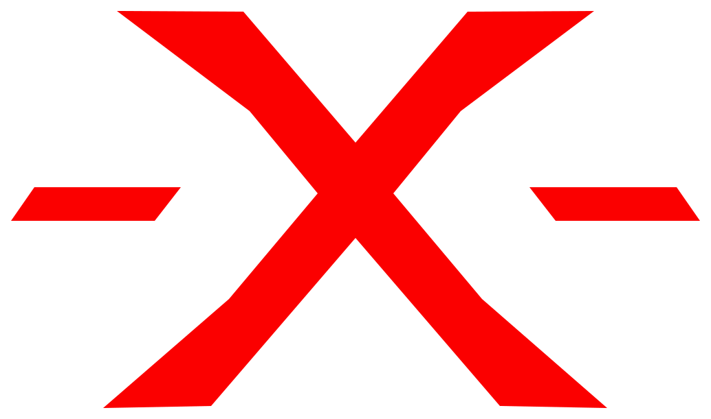
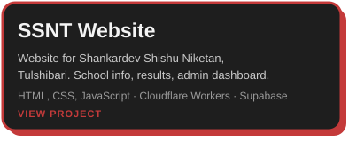
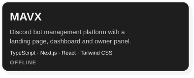
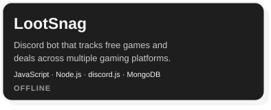
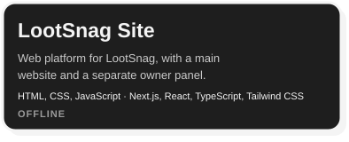

# Hey, I'm   

 

**Madhurjya Lahkar**

I'm a developer. I learn by building things and fixing them when they break.

- **Now:** finishing the [SSNT website](https://ssntulshibari.dpdns.org/).

- **Learning:** JavaScript in depth, TypeScript, React and Next.js.

---

### Tech Stack

**Front end**

**Backend**

**Tools**

---

### Projects

---

### GitHub Stats

 

  
  
  

